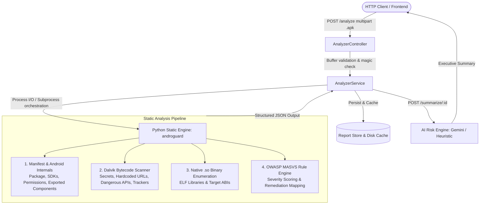

# 🔍 APK Inspector — Android Static Analysis & Reverse Engineering REST Service

[](https://github.com/Martin-JondaHealth/apk-inspector/actions/workflows/ci.yml)
[](https://nodejs.org/)
[](https://nestjs.com/)
[](https://www.python.org/)
[](https://mas.owasp.org/MASVS/)
[](https://opensource.org/licenses/MIT)

A high-performance backend REST service that reverse-engineers and statically analyzes Android APK binaries, outputting a structured OWASP MASVS security audit report and an AI-assisted executive risk assessment.

---

## 🎯 Architectural Overview



---

## 🚀 Key Features

* **Android Manifest & Internals Extraction:**
  * Package identifier, version name, internal version code, `minSdkVersion`, and `targetSdkVersion`.
  * Identification of declared permissions vs. Android Dangerous/Runtime permissions (`READ_SMS`, `ACCESS_FINE_LOCATION`, `CAMERA`, etc.).
  * Detection of unprotected **Exported Components** (Activities, Services, Broadcast Receivers, Content Providers).
  * Manifest security flags auditing (`android:debuggable`, `android:allowBackup`, `android:usesCleartextTraffic`).
  * Cryptographic signing scheme validation (v1 JAR, v2 APK Signing Block, v3).
* **Dalvik Bytecode & Smali Analysis:**
  * High-confidence regex extraction for hardcoded cloud credentials (AWS keys, Google API keys, JWT tokens, private keys).
  * Identification of unencrypted `http://` backend endpoints and staging domains.
  * Detection of hazardous Dalvik/Java APIs (`Runtime.exec`, `ProcessBuilder`, `DexClassLoader`, `WebView.addJavascriptInterface`).
  * Fingerprinting of embedded tracking/ad SDKs (Google Firebase, Adjust, AppsFlyer, Facebook SDK, Unity Ads).
* **Native C/C++ Inspection:**
  * Enumerates bundled native shared libraries (`lib/<abi>/*.so`).
  * Classifies supported CPU architectures (`arm64-v8a`, `armeabi-v7a`, `x86`, `x86_64`) to evaluate JNI memory safety attack surface.
* **OWASP MASVS Rule Engine:**
  * Maps every finding to MASVS categories (MASVS-STORAGE, MASVS-CRYPTO, MASVS-NETWORK, MASVS-PLATFORM, MASVS-CODE, MASVS-RESILIENCE).
  * Computes overall security grade (`A`, `B`, `C`, `D`, `F`) based on critical and high-risk findings.
* **AI-Assisted Executive Synthesis:**
  * Formulates plain-English risk summaries and prioritized remediation plans using Gemini / OpenAI, with an integrated zero-dependency heuristic fallback.
* **Production-Grade Developer Experience:**
  * Interactive OpenAPI Swagger documentation at `/api/docs`.
  * Complete E2E and Unit test suite with automated test APK generator.
  * Multi-stage Docker container & GitHub Actions CI pipeline.

---

## 📡 API Reference

| Method | Endpoint | Description |
|:---|:---|:---|
| `POST` | `/analyze` | Upload an `.apk` file (multipart), runs static analysis, returns `analysisId`. |
| `GET` | `/report/:id` | Retrieve full structured security audit JSON matching output contract. |
| `GET` | `/report/:id/summary` | Retrieve condensed findings (counts by severity, security grade, top risks). |
| `POST` | `/summarize/:id` | Generate an AI/heuristic plain-English executive risk report. |
| `GET` | `/reports` | List all analyzed packages stored in the local cache. |
| `GET` | `/health` | Service liveness, uptime, and Python/Androguard engine status. |
| `GET` | `/api/docs` | Interactive Swagger UI. |

---

## 📋 Report Contract (Sample Output)

```json
{
  "analysisId": "2a1bb0fc-4ea3-4d2c-b664-0e57c1b86d88",
  "apk": {
    "fileName": "app-release.apk",
    "sizeBytes": 1548290,
    "sha256": "d4877fe201bf6e9bbd94e2840af6d6da27f9331568bd7e9e14cb5b0d4745ef60"
  },
  "manifest": {
    "package": "com.example.vulnerableapp",
    "versionName": "2.1.0",
    "versionCode": 10,
    "minSdk": 21,
    "targetSdk": 30,
    "permissions": ["android.permission.INTERNET", "android.permission.ACCESS_FINE_LOCATION", "android.permission.READ_SMS"],
    "dangerousPermissions": ["android.permission.ACCESS_FINE_LOCATION", "android.permission.READ_SMS"],
    "exportedComponents": {
      "activities": [".MainActivity", ".DebugActivity"],
      "services": [".SyncService"],
      "receivers": [".PushReceiver"],
      "providers": []
    }
  },
  "security": {
    "debuggable": true,
    "allowBackup": true,
    "usesCleartextTraffic": true,
    "signingScheme": ["v1"],
    "findings": [
      {
        "id": "DEBUGGABLE_APP",
        "severity": "high",
        "title": "Application Is Debuggable",
        "evidence": "android:debuggable is set to \"true\" in AndroidManifest.xml",
        "recommendation": "Disable android:debuggable in production release builds to prevent process memory inspection via JDWP/jdb.",
        "owaspCategory": "MASVS-RESILIENCE"
      },
      {
        "id": "HARDCODED_SECRETS",
        "severity": "critical",
        "title": "Hardcoded Secrets Detected in Bytecode",
        "evidence": "Found 2 potential hardcoded credentials (AWS Access Key, Google API Key)",
        "recommendation": "Remove embedded credentials from bytecode. Store sensitive API keys in backend vaults.",
        "owaspCategory": "MASVS-STORAGE"
      }
    ]
  },
  "codeInsights": {
    "hardcodedUrls": ["http://api.internal.corp/v1/debug-telemetry"],
    "possibleSecrets": [
      {
        "pattern": "AWS Access Key",
        "location": "classes.dex",
        "evidence": "AKIA************MPLE",
        "severity": "critical"
      }
    ],
    "dangerousApiCalls": ["DexClassLoader", "Runtime.exec", "WebView.addJavascriptInterface"],
    "trackers": ["Adjust SDK", "Google Firebase"]
  },
  "native": {
    "libs": [
      { "name": "libnative-security.so", "abi": "arm64-v8a" },
      { "name": "libnative-security.so", "abi": "armeabi-v7a" }
    ],
    "abis": ["arm64-v8a", "armeabi-v7a"]
  },
  "aiSummary": null
}
```

---

## 🛠️ Quickstart

### Prerequisites
* Node.js 20+
* Python 3.10+

### 1. Installation
```bash
git clone https://github.com/Martin-JondaHealth/apk-inspector.git
cd apk-inspector

# Install Node dependencies
npm install

# Setup Python virtualenv
python3 -m venv .venv
source .venv/bin/activate
pip install -r engine/requirements.txt
```

### 2. Generate Test APK & Run Tests
```bash
# Generate benign sample test APK
python3 engine/create_test_apk.py sample-test.apk

# Run unit tests
npm test

# Run End-to-End tests
npm run test:e2e
```

### 3. Start the Server
```bash
# Development mode
npm run start:dev

# Production mode
npm run build
npm run start:prod
```

API will be live at `http://localhost:3000` with Swagger documentation at `http://localhost:3000/api/docs`.

### 4. Example Usage
```bash
# 1. Upload APK for analysis
curl -X POST http://localhost:3000/analyze \
  -F "file=@sample-test.apk"

# 2. Retrieve Full Report
curl -X GET http://localhost:3000/report/<analysisId>

# 3. Retrieve Condensed Summary & Grade
curl -X GET http://localhost:3000/report/<analysisId>/summary

# 4. Generate AI Risk Assessment
curl -X POST http://localhost:3000/summarize/<analysisId>
```

---

## 🐳 Docker Deployment

```bash
docker-compose up -d --build
```

---

## 📄 Resume Integration Guide

For detailed explanations of the underlying Android internals, Dalvik bytecode, native C/C++ concepts, and interview talking points, refer to [RESUME_GUIDE.md](RESUME_GUIDE.md).
